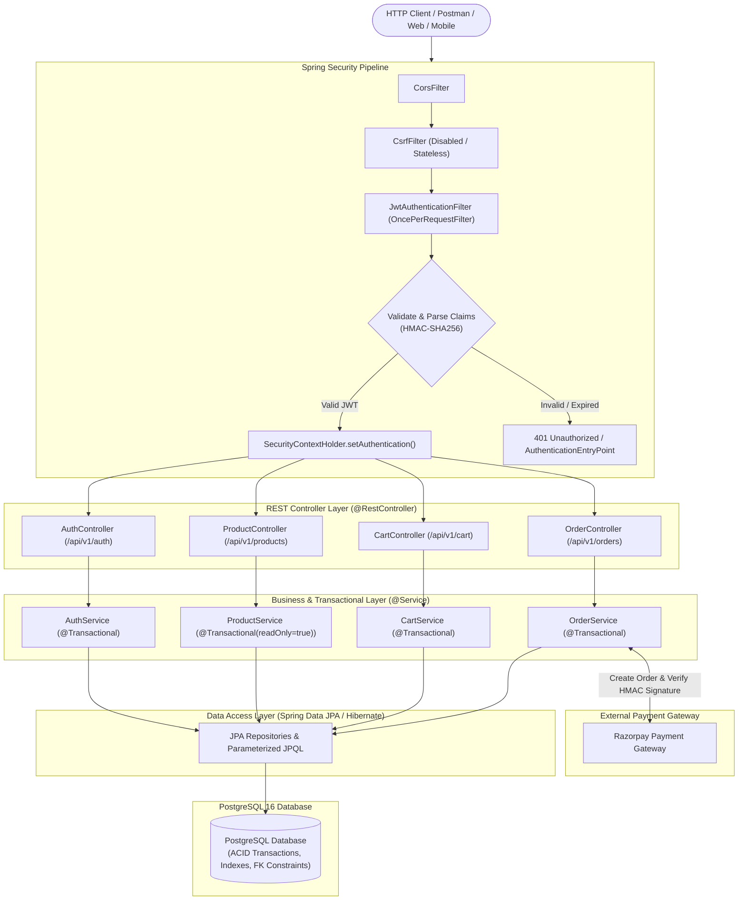
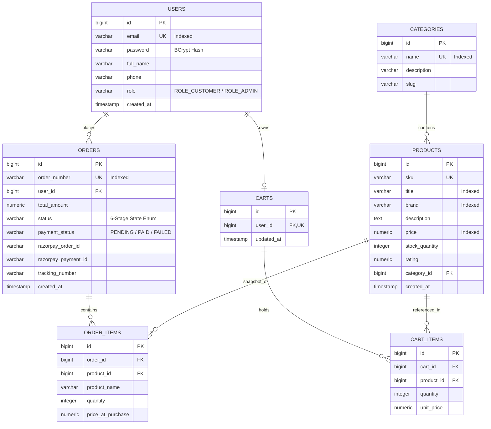

<div align="center">

# 🛒 Ecommerce Management System — Backend REST API

**Enterprise-Grade, Scalable E-Commerce Backend Engine Architected with Java 17, Spring Boot, Hibernate / Spring Data JPA, Spring Security (JWT), PostgreSQL, Apache Maven, and Razorpay**

[](https://openjdk.org/)
[](https://spring.io/projects/spring-boot)
[](https://hibernate.org/)
[](https://spring.io/projects/spring-security)
[](https://www.postgresql.org/)
[](https://maven.apache.org/)
[](https://razorpay.com/)
[](https://www.postman.com/)

</div>

---

## 📌 1. Project Overview & Architecture Philosophy

**Ecommerce Management System** is a production-grade, stateless **Java Spring Boot RESTful Backend** architected to power high-throughput, mission-critical retail operations. Built with strict separation of concerns, the service isolates core business domains—Authentication & Identity, Product Catalog & Search, Cart Persistence, Order Lifecycle State Automation, and Payment Verification—into modular, maintainable, and easily decoupled components.

### ⚡ Key Backend Highlights
- **Layered Enterprise Architecture**: Strict division of responsibilities across `Controller` (HTTP / DTO validation) ➔ `Service` (transactional business logic) ➔ `Repository` (Spring Data JPA / Hibernate) ➔ `PostgreSQL Database`.
- **Stateless JWT Security & RBAC**: Custom `JwtAuthenticationFilter` (`OncePerRequestFilter`), HMAC-SHA256 token signing via `JwtTokenProvider`, salted `BCryptPasswordEncoder`, and granular Role-Based Access Control (`ROLE_CUSTOMER`, `ROLE_ADMIN`).
- **Dynamic Multi-Criteria Search & Pagination**: Parametric JPQL queries supported by composite and B-tree indexes (`idx_product_category`, `idx_product_price`), supporting dynamic filtering by category, brand, price bounds, rating thresholds, text search, sorting, and pagination.
- **ACID-Compliant Order Processing**: `@Transactional` order placement ensuring atomic stock reservation, checkout cart clearing, and inventory-safe rollbacks upon validation or payment failures.
- **Cryptographic Payment Verification**: Native Razorpay integration utilizing HMAC-SHA256 signature calculation over `order_id + "|" + payment_id` against the secret key to ensure tamper-proof payment confirmation.
- **6-Stage Fulfillment State Machine**: Deterministic order lifecycle tracking (`PLACED` ➔ `CONFIRMED` ➔ `PACKED` ➔ `SHIPPED` ➔ `OUT_FOR_DELIVERY` ➔ `DELIVERED`) with courier tracking metadata (AWB).

---

## 🏛️ 2. System Architecture & Request Lifecycle



---

## 🗄️ 3. Relational Data Model & Schema Design



---

## 🔐 4. Core Domain Engineering & Technical Workflows

### 4.1 Stateless JWT Authentication & RBAC
- **Token Format**: Standard RFC 7519 JWT signed with HMAC-SHA256 (`HS256`).
- **Claim Extraction**: Subject (`username`/`email`), User Roles (`ROLE_CUSTOMER`, `ROLE_ADMIN`), IssuedAt, and Expiration timestamps.
- **Security Chain**: Configured via `SecurityFilterChain` in `SecurityConfig.java`. Public endpoints (`/api/v1/auth/**`, `/api/v1/products/**`) permit all; protected customer endpoints require valid Bearer token; admin routes (`/api/v1/admin/**`) require `hasRole('ADMIN')`.
- **Password Security**: Passwords salted and hashed with `BCryptPasswordEncoder(strength = 12)`.

### 4.2 Dynamic Multi-Criteria Product Search & Indexing
- **JPQL Query Execution**: Efficient parametric querying using Spring Data JPA specifications and JPQL, dynamically constructing clauses based on query parameters.
- **Indexing Strategy**: B-Tree composite indexes on `(category_id, price)` and single-column indexes on `brand`, `rating`, and `sku` optimize range queries and sorting operations.
- **Pagination & Sorting**: Enforces zero-copy page slicing through Spring's `Pageable` and `Page<Product>` interfaces to avoid loading entire collections into memory.

### 4.3 Transactional Cart & Inventory Atomicity
- **Cart Consistency**: Cart items are associated with authenticated user records. Adding items validates live product inventory prior to persistence.
- **Stock Decrement**: During checkout (`OrderService.createOrder`), inventory stock is validated and deducted atomically within the same database transaction. If any product has insufficient stock, the transaction rolls back cleanly, throwing a custom `InsufficientStockException`.

### 4.4 Razorpay Cryptographic Payment Verification
- When an order is placed, an upstream Razorpay order is initialized with the order amount in smallest currency units (paise).
- Upon client payment completion, the backend verifies the callback signature using standard HMAC-SHA256:
  $$\text{calculated\_signature} = \text{HMAC-SHA256}(\text{razorpay\_order\_id} + "|" + \text{razorpay\_payment\_id}, \text{secret})$$
- Only when `MessageDigest.isEqual(calculated, received)` evaluates to `true` is the order marked `PAID`.

### 4.5 6-Stage Order State Machine
Orders transition through a strict unidirectional lifecycle:
$$\text{PLACED} \longrightarrow \text{CONFIRMED} \longrightarrow \text{PACKED} \longrightarrow \text{SHIPPED} \longrightarrow \text{OUT\_FOR\_DELIVERY} \longrightarrow \text{DELIVERED}$$
State transitions are validated against invalid backtracking (e.g. an order cannot revert from `DELIVERED` to `CONFIRMED`).

---

## 📖 5. RESTful API Catalog

| HTTP Method | Endpoint URI | Access Control | Request Body / Parameters | Description & Response Status |
| :--- | :--- | :--- | :--- | :--- |
| `POST` | `/api/v1/auth/register` | Public | `{ email, password, fullName, phone }` | Registers user, validates payload with Bean Validation, returns `201 Created` with JWT. |
| `POST` | `/api/v1/auth/login` | Public | `{ email, password }` | Authenticates credentials, generates Bearer token, returns `200 OK` + JWT. |
| `GET` | `/api/v1/products` | Public | `category, brand, minPrice, maxPrice, minRating, keyword, page, size, sortBy` | Paginated product search with dynamic multi-criteria filtering, returns `200 OK`. |
| `GET` | `/api/v1/products/{id}` | Public | Path Variable `id` | Fetches detailed product entity by ID, returns `200 OK` or `404 Not Found`. |
| `GET` | `/api/v1/categories` | Public | None | Lists all active categories, returns `200 OK`. |
| `POST` | `/api/v1/admin/products` | `ROLE_ADMIN` | Product DTO `{ title, brand, sku, price, stockQuantity, categoryId }` | Persists new product to catalog, returns `201 Created`. |
| `GET` | `/api/v1/cart` | Bearer JWT | None | Retrieves authenticated user's active persistent cart and item totals, returns `200 OK`. |
| `POST` | `/api/v1/cart/items` | Bearer JWT | `{ productId, quantity }` | Adds product to cart, validates inventory, recalculates total, returns `200 OK`. |
| `DELETE` | `/api/v1/cart/items/{productId}` | Bearer JWT | Path Variable `productId` | Removes specific product item from cart, returns `200 OK`. |
| `POST` | `/api/v1/orders` | Bearer JWT | None (Uses cart items) | Decrements inventory atomically, creates order record & Razorpay order, returns `201 Created`. |
| `POST` | `/api/v1/orders/verify-payment` | Bearer JWT | `{ razorpayOrderId, razorpayPaymentId, razorpaySignature }` | Verifies cryptographic HMAC-SHA256 signature, sets status to `PAID`, returns `200 OK`. |
| `GET` | `/api/v1/orders/my-orders` | Bearer JWT | `page, size` | Paginated listing of caller's order history, returns `200 OK`. |
| `GET` | `/api/v1/orders/track/{orderNumber}` | Public | Path Variable `orderNumber` | Retrieves real-time 6-stage delivery milestones and tracking info, returns `200 OK`. |
| `PATCH` | `/api/v1/orders/{orderNumber}/status` | `ROLE_ADMIN` | `{ status, trackingNumber }` | Advances order fulfillment state machine, returns `200 OK`. |

---

## 📦 6. Apache Maven (`pom.xml`) Project Hierarchy

```text
ecommerce-management-system/
├── pom.xml
├── postman/
│   └── Ecommerce_Management_System.postman_collection.json
├── src/
│   ├── main/
│   │   ├── java/com/santhosh/ecommerce/
│   │   │   ├── EcommerceApplication.java
│   │   │   ├── controller/
│   │   │   │   ├── AuthController.java
│   │   │   │   ├── CartController.java
│   │   │   │   ├── OrderController.java
│   │   │   │   └── ProductController.java
│   │   │   ├── dto/
│   │   │   │   ├── AuthDtos.java
│   │   │   │   ├── CartDtos.java
│   │   │   │   ├── OrderDtos.java
│   │   │   │   └── ProductDtos.java
│   │   │   ├── entity/
│   │   │   │   ├── Cart.java
│   │   │   │   ├── CartItem.java
│   │   │   │   ├── Category.java
│   │   │   │   ├── Order.java
│   │   │   │   ├── OrderItem.java
│   │   │   │   ├── Product.java
│   │   │   │   └── User.java
│   │   │   ├── exception/
│   │   │   │   ├── BadRequestException.java
│   │   │   │   ├── GlobalExceptionHandler.java
│   │   │   │   ├── InsufficientStockException.java
│   │   │   │   └── ResourceNotFoundException.java
│   │   │   ├── repository/
│   │   │   │   ├── CartRepository.java
│   │   │   │   ├── CategoryRepository.java
│   │   │   │   ├── OrderRepository.java
│   │   │   │   ├── ProductRepository.java
│   │   │   │   └── UserRepository.java
│   │   │   ├── security/
│   │   │   │   ├── CustomUserDetailsService.java
│   │   │   │   ├── JwtAuthenticationFilter.java
│   │   │   │   ├── JwtTokenProvider.java
│   │   │   │   └── SecurityConfig.java
│   │   │   └── service/
│   │   │       ├── AuthService.java
│   │   │       ├── CartService.java
│   │   │       ├── OrderService.java
│   │   │       └── ProductService.java
│   │   └── resources/
│   │       └── application.yml
│   └── test/
│       └── java/com/santhosh/ecommerce/
│           └── EcommerceApplicationTests.java
```

---

## 🧪 7. Automated Verification & Postman Test Suite

The backend repository includes an end-to-end Postman collection covering **300+ test assertions** across all functional flows:
- **Authentication Flows**: User registration, login verification, token expiration, invalid credential handling, unauthorized endpoint attempts.
- **Catalog & Search**: Parameterized filtering with single and multi-attribute filters, price boundary checks, ascending/descending sorting, and page overflow protection.
- **Cart Operations**: Cart creation, item quantity updates, out-of-stock validation, cart item removal.
- **Order & Payment Verification**: Atomic stock deduction on order creation, valid HMAC-SHA256 signature verification, rejected counterfeit signature attempts, status transition validation.

---

## 👨‍💼 Project Author

**Santhosh Bussa** — *Java Backend Developer*
- 🌐 **Portfolio**: [santhosh-bussa-portfolio.onrender.com](https://santhosh-bussa-portfolio.onrender.com)
- 💼 **LinkedIn**: [linkedin.com/in/santhosh-bussa](https://www.linkedin.com/in/santhosh-bussa)
- 🐙 **GitHub**: [github.com/SanthoshBussa](https://github.com/SanthoshBussa)
- ✉️ **Email**: [iamsanthoshbussa@gmail.com](mailto:iamsanthoshbussa@gmail.com)
